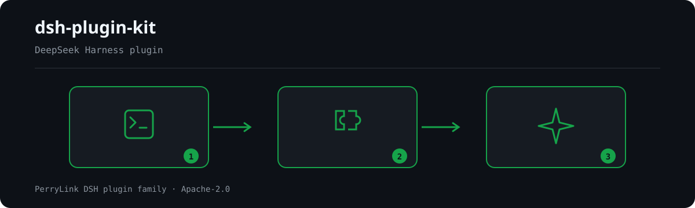

# @perrylink/dsh-plugin-kit

面向 PerryLink DSH 插件仓库的共享**零运行时依赖**工具包。逐项审计发现 20+ 插件各自手写同样的 Provider seam、并重复相同的 sanitize/pricing/裁决形状，因此本包把 这一切——可插拔 Provider seam、fail-closed 审批门与自适应会话事件门、机械校验脚本、共享 的 sanitize/pricing/judge 纯函数模块——抽取进一个 ESM + TypeScript 包。

> **包名说明。** 本项目的 npm 发布名是 **`@perrylink/dsh-plugin-kit`**。裸名 `dsh-plugin-kit` 属于另一个无关项目——装它不会装到本包。

- **1024 商店渠道**：先 `npm i -g dsh1024`，再 `dsh1024 plugin --profile web add @perrylink/dsh-plugin-kit`（计入 [deepseek1024.com](https://deepseek1024.com) 安装排行）。

[](https://www.npmjs.com/package/@perrylink/dsh-plugin-kit)
[](LICENSE)
[](https://github.com/topics/dsh-plugin)
[](https://dsh.market/)
[](#)
[](https://gitee.com/perrylink/dsh-plugin-kit)
[](https://github.com/PerryLink/dsh-plugin-kit/actions)
[](https://github.com/PerryLink/dsh-plugin-kit/releases)
[](https://www.npmjs.com/package/@perrylink/dsh-plugin-kit)
[](https://dshfind.com/zh/plugins/PerryLink/dsh-plugin-kit?ref=badge)

[English](README.md) | **简体中文** | [Español](README-es.md) | [Português](README-pt.md) | [हिन्दी](README-hi.md)

```sh
dsh plugin --profile <name> add @perrylink/dsh-plugin-kit
```


面向 PerryLink DSH 插件仓库的共享**零运行时依赖**工具包。逐项审计发现 20+ 插件
各自手写同样的 Provider seam、并重复相同的 sanitize/pricing/裁决形状，因此本包把
这一切——可插拔 Provider seam、fail-closed 审批门与自适应会话事件门、机械校验脚本、共享
的 sanitize/pricing/judge 纯函数模块——抽取进一个 ESM + TypeScript 包。

## What is dsh-plugin-kit?

面向 PerryLink DSH 插件仓库的共享**零运行时依赖**工具包。逐项审计发现 20+ 插件各自手写同样的 Provider seam、并重复相同的 sanitize/pricing/裁决形状，因此本包把 这一切——可插拔 Provider seam、fail-closed 审批门与自适应会话事件门、机械校验脚本、共享 的 sanitize/pricing/judge 纯函数模块——抽取进一个 ESM + TypeScript 包。



*工作流概览：调用 → 插件 → 结果。下面的示例使用实际命令面。*


*同一次运行，动图版。*

## 兼容性

- **DSH harness**：本包运行时零 `@deepseek-ai/*` import。`@deepseek-ai/cordis`
  （`^4.0.5-alpha.1`）、`@deepseek-ai/schemastery`（`^3.18.5-alpha.1`）与各 `@deepseek-ai/dsh-*`
  包均声明为**可选** peer 依赖，区间与 PerryLink 各插件仓一致（`>=0.1.2-rc.1 <0.2.0 || >=0.1.5-alpha.1 <0.2.0 || >=0.1.6-0 <0.2.0 || >=0.1.7-0 <0.2.0 || >=0.2.0-0 <0.3.0 || >=0.2.1-0 <0.3.0`），仅用于
  类型互通。已于 2026-09-11 针对 `dsh-v0.1.7-alpha.1` master checkout 核验（全量门禁链 + profile 安装冒烟测试），并已于 2026-10-05 针对 `dsh-v0.2.1-alpha.1` checkout 复核（全量门禁链 + profile 安装冒烟测试）。
- **Node**：`^22.19.0 || >=24.0.0`，仅 ESM。
- **线级兼容**：函数名与形状对齐 `dsh-mask`（sanitize）、`dsh-budget`（pricing）、
  `dsh-auto-review`（judge 与 `fallbackPolicy` 词汇），迁移是机械替换。

## 你能得到什么

- **零运行时依赖**——纯核心（`seam` / `gates` / `shared`）浏览器侧可用。
- **ESM + 严格 TypeScript**——每个模块带 JSDoc 契约；开启 `strict`、
  `noUncheckedIndexedAccess`、`exactOptionalPropertyTypes`。
- **fail-closed 与自适应门**——审批永不默认放行；会话事件追加在拒绝未知事件类型的
  宿主上优雅降级。
- **新插件骨架**——`template/` 含 `cordis.yml`、三角色 `src/index.ts`（Service
  Definition / Provider / Consumer）、最小测试与共享 Renovate 预设。

## 快速开始

```sh
dsh plugin --profile web add github:PerryLink/dsh-plugin-kit
```

npm 通道：

```sh
pnpm add @perrylink/dsh-plugin-kit
```

git 通道（`prepare` 脚本只用生产依赖构建 `lib/`）：

```sh
pnpm add github:PerryLink/dsh-plugin-kit
```

一步替换手写注册表：

```ts
import { ProviderRegistry } from '@perrylink/dsh-plugin-kit/seam'

const registry = new ProviderRegistry<Detector>({
  default: { name: 'regex', impl: new RegexDetector() },
})
ctx.effect(() => registry.register('ner', new NerDetector()))
const active = registry.use('ner') ?? registry.use()
```

## 安装与卸载

安装即 `pnpm add`（见快速开始）。本包还带一层**有意留空**的 `dsh.bundle.patch`（`cordis.patch.yml`），因此当某个 profile 想把本 kit 作为包挂载时，它也能走 harness 的 bundle 通道：

```sh
# npm 渠道（正式发布版）
dsh plugin --profile web add @perrylink/dsh-plugin-kit

# git 渠道（最新 master）
dsh plugin --profile web add github:PerryLink/dsh-plugin-kit
```

移除：

```sh
pnpm remove @perrylink/dsh-plugin-kit
```

不注册任何全局状态：卸载就是安装的精确逆操作。

### 示例

以下为插件真实入口；安装后调用一个即可。

#### 详细示例

- `sanitize`

#### 简短示例

- `applyFailClosed`
- `parseVerdict`

## 配置

无运行时配置：门与辅助函数均为纯函数。唯一配置面是 `cordis.patch.yml`——随包发布的
bundle-patch 层，供 harness profile 组合使用；它不挂载插件行（本包是库），并说明消费
插件如何添加自己的行。

## 工具与表面

| 子路径 | 用途 |
|---|---|
| `seam` | `ProviderRegistry<T>`——可逆、重名响亮失败的具名 Provider 注册表。 |
| `gates` | `applyFailClosed`；`makeEventGate` / `maybeAppendSessionEvent` / `probeIgnorableAppend`。 |
| `shared` | `sanitize`（`Stripper`、`redactText`、`redactMapping`、`sanitizeText`、`sanitizeUrl`）、`pricing`（`BUILTIN_PRICES`、`estimateUsageCost`、`tokenCarbon`、`latencyStats`、`formatMoney`、`formatTokens`）、`judge`（`parseVerdict`、`VERDICT_SCHEMA`、`riskExceeds`）。 |
| `verify` | 机械 CI 门（`verify-license`、`verify-readme-languages`、`verify-seam`），返回 `VerifyReport` 且 CLI 以非零码失败：`node lib/verify/cli.js all .` |
| `template/` | 新插件骨架（`cordis.yml`、三角色插件、测试、README、`renovate.json5`）。 |
| 根 barrel | 重导出以上全部。 |

## 权限与数据

本包自身不做任何 I/O、网络访问或子进程启动。`Stripper` 的占位符→原文映射只存内存，
`stats()`/`redactMapping()` 绝不输出明文；持久化映射的消费方自行承担该决策及其存储权限。

## 安全边界

- `sanitize`/`redact*` 是**展示卫生**，不是安全边界：它们降低日志与结果中的泄露，
  不做认证或授权。
- 审批门默认 fail closed（`rejected`）；唯一放行路径是显式 `allow-once` 选择。
- 宿主拒绝的会话事件追加会被跳过，绝不重试到破坏会话 resume 的程度。
- 漏洞请走 GitHub Security Advisories——见 `SECURITY.md`。

## 已知限制

- `Session.append` 第三参为 `SurfaceIntent` 的宿主（`0.1.2-rc.1`）会对 ignorable
  信封探测抛 `validateNext`；门退化为跳过未知类型，即该类宿主上审计事件被丢弃
  （fail closed）而非写入。
- 0.1.2-rc.1（2026-09-02 已适配）：会话信封保留 ignorable 字段但仅用于存量日志读取兼容——Session.append 仍无法盖章，门控行为不变。
- 本包无浏览器 UI 半：它是被其他插件 Host（及可选 Client）半消费的库。

## 开发

```sh
pnpm install
pnpm run typecheck        # tsc --noEmit
pnpm run typecheck:ci     # CI 面：tsc -p tsconfig.ci.json --noEmit
pnpm test                 # vitest 单测
pnpm run build            # 产出 lib/ 与声明（prepare 也会执行）
pnpm run verify:self-contained
pnpm run verify:artifacts
```

## 主题

本仓库同时是整个生态的维护枢纽：`scripts/sync-peer-range.mjs` 一条命令重钉目标目录里所有仓的
共享 peer 区间，`renovate/default.json5` 是各仓统一继承的 Renovate 预设，
`.github/workflows/npm-publish.yml` 是可复用的 tag 触发发布工作流（只需一个
`NPM_TOKEN` secret），`data/repos.json` 是门户消费的生态注册表。见
[docs/ecosystem-tooling.md](docs/ecosystem-tooling.md)。

关键词：dsh、dsh-plugin、deepseek-harness、deepseek、cordis、perrylink、provider、
seam、approval、sanitize、pricing、judge。

## 贡献者

由 [PerryLink](https://github.com/PerryLink) 维护，DSH 插件生态共建。

## 许可证

Apache-2.0——见 [LICENSE](LICENSE)。

## PerryLink DSH Plugin Family

本项目是 [PerryLink](https://github.com/PerryLink) 维护的 DeepSeek Harness 插件家族成员。完整名单默认折叠，避免每个 README 的首屏被长表淹没；点击展开可查看每一行及其状态。

<details>
<summary>展开全部插件</summary>

| 插件 | 状态 |
|---|---|
| **[dsh-aqua-input-check](https://github.com/PerryLink/dsh-aqua-input-check)** |  |
| **[dsh-archive-check](https://github.com/PerryLink/dsh-archive-check)** |  |
| **[dsh-auto-review](https://github.com/PerryLink/dsh-auto-review)** |  |
| **[dsh-autotier](https://github.com/PerryLink/dsh-autotier)** |  |
| **[dsh-bid-ca-precheck](https://github.com/PerryLink/dsh-bid-ca-precheck)** |  |
| **[dsh-bid-qual-check](https://github.com/PerryLink/dsh-bid-qual-check)** |  |
| **[dsh-cert-mcp](https://github.com/PerryLink/dsh-cert-mcp)** |  |
| **[dsh-checkpoint-rewind](https://github.com/PerryLink/dsh-checkpoint-rewind)** |  |
| **[dsh-click](https://github.com/PerryLink/dsh-click)** |  |
| **[dsh-composer-history](https://github.com/PerryLink/dsh-composer-history)** |  |
| **[dsh-contract-stance](https://github.com/PerryLink/dsh-contract-stance)** |  |
| **[dsh-customs-doc-check](https://github.com/PerryLink/dsh-customs-doc-check)** |  |
| **[dsh-data-quality](https://github.com/PerryLink/dsh-data-quality)** |  |
| **[dsh-demurrage-ledger](https://github.com/PerryLink/dsh-demurrage-ledger)** |  |
| **[dsh-doublecheck](https://github.com/PerryLink/dsh-doublecheck)** |  |
| **[dsh-drill-script-check](https://github.com/PerryLink/dsh-drill-script-check)** |  |
| **[dsh-eia-guide-check](https://github.com/PerryLink/dsh-eia-guide-check)** |  |
| **[dsh-emergency-plan](https://github.com/PerryLink/dsh-emergency-plan)** |  |
| **[dsh-essay-rubric-check](https://github.com/PerryLink/dsh-essay-rubric-check)** |  |
| **[dsh-evidence-check](https://github.com/PerryLink/dsh-evidence-check)** |  |
| **[dsh-export-ctl-check](https://github.com/PerryLink/dsh-export-ctl-check)** |  |
| **[dsh-fast](https://github.com/PerryLink/dsh-fast)** |  |
| **[dsh-fmea-table-check](https://github.com/PerryLink/dsh-fmea-table-check)** |  |
| **[dsh-forecast-penalty](https://github.com/PerryLink/dsh-forecast-penalty)** |  |
| **[dsh-fund-research](https://github.com/PerryLink/dsh-fund-research)** |  |
| **[dsh-github](https://github.com/PerryLink/dsh-github)** |  |
| **[dsh-gongwen-flow-check](https://github.com/PerryLink/dsh-gongwen-flow-check)** |  |
| **[dsh-gongwen-word-check](https://github.com/PerryLink/dsh-gongwen-word-check)** |  |
| **[dsh-guard-plan-qc](https://github.com/PerryLink/dsh-guard-plan-qc)** |  |
| **[dsh-hazchem-check](https://github.com/PerryLink/dsh-hazchem-check)** |  |
| **[dsh-hazplan-check](https://github.com/PerryLink/dsh-hazplan-check)** |  |
| **[dsh-hidden-risk-map](https://github.com/PerryLink/dsh-hidden-risk-map)** |  |
| **[dsh-hs-classify](https://github.com/PerryLink/dsh-hs-classify)** |  |
| **[dsh-icd-rule-check](https://github.com/PerryLink/dsh-icd-rule-check)** |  |
| **[dsh-industry-research](https://github.com/PerryLink/dsh-industry-research)** |  |
| **[dsh-lawcite-adapter](https://github.com/PerryLink/dsh-lawcite-adapter)** |  |
| **[dsh-laya](https://github.com/PerryLink/dsh-laya)** |  |
| **[dsh-lc-doc-check](https://github.com/PerryLink/dsh-lc-doc-check)** |  |
| **[dsh-learning-gap-check](https://github.com/PerryLink/dsh-learning-gap-check)** |  |
| **[dsh-library](https://github.com/PerryLink/dsh-library)** |  |
| **[dsh-local-ai](https://github.com/PerryLink/dsh-local-ai)** |  |
| **[dsh-lsp-actions](https://github.com/PerryLink/dsh-lsp-actions)** |  |
| **[dsh-mask](https://github.com/PerryLink/dsh-mask)** |  |
| **[dsh-mcp-panel](https://github.com/PerryLink/dsh-mcp-panel)** |  |
| **[dsh-medrec-qc](https://github.com/PerryLink/dsh-medrec-qc)** |  |
| **[dsh-memento](https://github.com/PerryLink/dsh-memento)** |  |
| **[dsh-nsfc-form-check](https://github.com/PerryLink/dsh-nsfc-form-check)** |  |
| **[dsh-nurse-record-check](https://github.com/PerryLink/dsh-nurse-record-check)** |  |
| **[dsh-observe](https://github.com/PerryLink/dsh-observe)** |  |
| **[dsh-origin-rvc-check](https://github.com/PerryLink/dsh-origin-rvc-check)** |  |
| **[dsh-ota-review-check](https://github.com/PerryLink/dsh-ota-review-check)** |  |
| **[dsh-output-styles](https://github.com/PerryLink/dsh-output-styles)** |  |
| **[dsh-paper-doc-adapter](https://github.com/PerryLink/dsh-paper-doc-adapter)** |  |
| **[dsh-permission-rules](https://github.com/PerryLink/dsh-permission-rules)** |  |
| **[dsh-permit-report-check](https://github.com/PerryLink/dsh-permit-report-check)** |  |
| **[dsh-pipeline-check](https://github.com/PerryLink/dsh-pipeline-check)** |  |
| **[dsh-pleading-draft](https://github.com/PerryLink/dsh-pleading-draft)** |  |
| **[dsh-plugin-doctor](https://github.com/PerryLink/dsh-plugin-doctor)** |  |
| **[dsh-plugin-guide](https://github.com/PerryLink/dsh-plugin-guide)** |  |
| **[dsh-plugin-kit](https://github.com/PerryLink/dsh-plugin-kit)** |  |
| **[dsh-plugin-upgrade](https://github.com/PerryLink/dsh-plugin-upgrade)** |  |
| **[dsh-policy-brief-draft](https://github.com/PerryLink/dsh-policy-brief-draft)** |  |
| **[dsh-power-loss-split](https://github.com/PerryLink/dsh-power-loss-split)** |  |
| **[dsh-power-ticket-check](https://github.com/PerryLink/dsh-power-ticket-check)** |  |
| **[dsh-ppap-check](https://github.com/PerryLink/dsh-ppap-check)** |  |
| **[dsh-protest-deadline](https://github.com/PerryLink/dsh-protest-deadline)** |  |
| **[dsh-railway-window](https://github.com/PerryLink/dsh-railway-window)** |  |
| **[dsh-repair-order-qc](https://github.com/PerryLink/dsh-repair-order-qc)** |  |
| **[dsh-research-report](https://github.com/PerryLink/dsh-research-report)** |  |
| **[dsh-review-reply-check](https://github.com/PerryLink/dsh-review-reply-check)** |  |
| **[dsh-rulefile-check](https://github.com/PerryLink/dsh-rulefile-check)** |  |
| **[dsh-safety-brief-check](https://github.com/PerryLink/dsh-safety-brief-check)** |  |
| **[dsh-score](https://github.com/PerryLink/dsh-score)** |  |
| **[dsh-session-sync](https://github.com/PerryLink/dsh-session-sync)** |  |
| **[dsh-site-log-check](https://github.com/PerryLink/dsh-site-log-check)** |  |
| **[dsh-skill-pack-security](https://github.com/PerryLink/dsh-skill-pack-security)** |  |
| **[dsh-soe-decision-check](https://github.com/PerryLink/dsh-soe-decision-check)** |  |
| **[dsh-soilwater-check](https://github.com/PerryLink/dsh-soilwater-check)** |  |
| **[dsh-sop-sync-check](https://github.com/PerryLink/dsh-sop-sync-check)** |  |
| **[dsh-spc-gbt-adapter](https://github.com/PerryLink/dsh-spc-gbt-adapter)** |  |
| **[dsh-talk](https://github.com/PerryLink/dsh-talk)** |  |
| **[dsh-tender-extract](https://github.com/PerryLink/dsh-tender-extract)** |  |
| **[dsh-tender-matrix](https://github.com/PerryLink/dsh-tender-matrix)** |  |
| **[dsh-test-drive](https://github.com/PerryLink/dsh-test-drive)** |  |
| **[dsh-ticktick](https://github.com/PerryLink/dsh-ticktick)** |  |
| **[dsh-translate](https://github.com/PerryLink/dsh-translate)** |  |
| **[dsh-warranty-calc](https://github.com/PerryLink/dsh-warranty-calc)** |  |
| **[dsh-budget](https://github.com/PerryLink/dsh-budget)** | 🧊 已冻结 — 见仓库 README |
| **[dsh-claude-move](https://github.com/PerryLink/dsh-claude-move)** | 🧊 已冻结 — 见仓库 README |
| **[dsh-defend](https://github.com/PerryLink/dsh-defend)** | 🧊 已冻结 — 见仓库 README |
| **[dsh-draw](https://github.com/PerryLink/dsh-draw)** | 🧊 已冻结 — 见仓库 README |
| **[dsh-reach](https://github.com/PerryLink/dsh-reach)** | 🧊 已冻结 — 见仓库 README |
| **[dsh-background-agents](https://github.com/PerryLink/dsh-background-agents)** | 🚫 已退役 — 见仓库 README |
| **[dsh-session-pin](https://github.com/PerryLink/dsh-session-pin)** | 🚫 已退役 — 见仓库 README |
| **[dsh-team-rooms](https://github.com/PerryLink/dsh-team-rooms)** | 🚫 已退役 — 见仓库 README |

</details>
